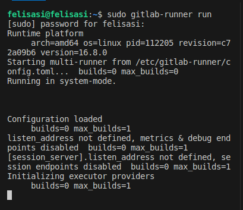
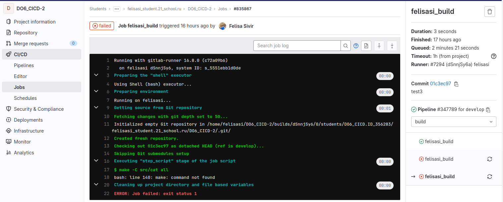
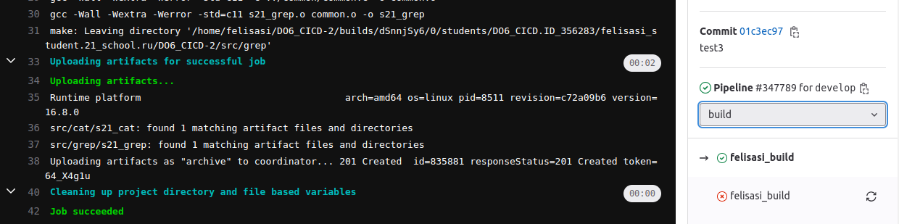
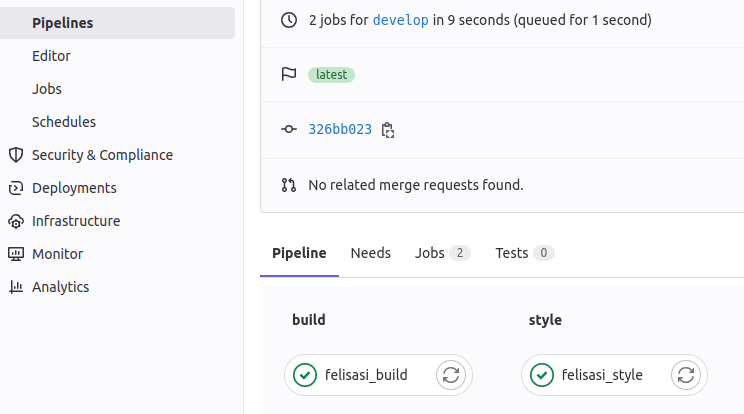
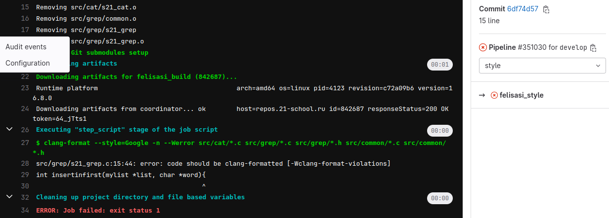
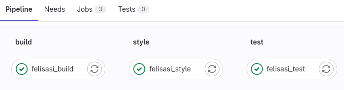
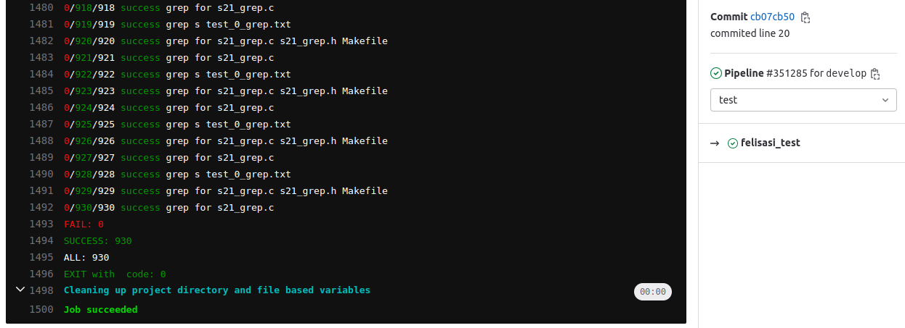
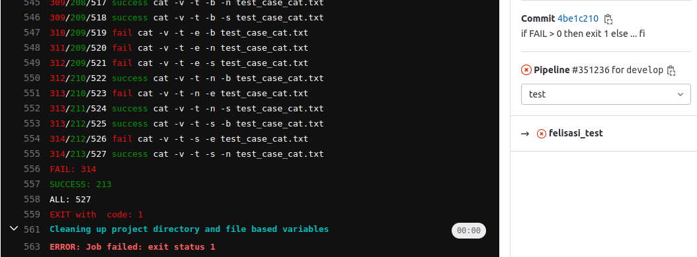
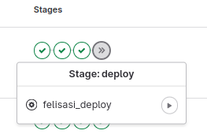
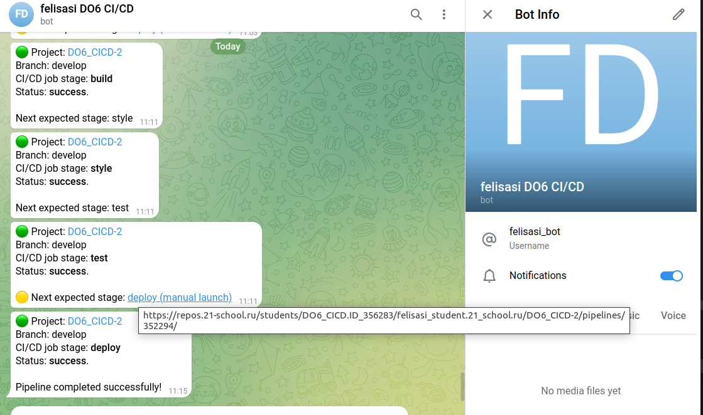

# Описание действий при выполнения проекта Continuous Integration/Continuous Deployment.

## Предварительные настройки
- Пока виртуальные машины отключены вносим изменения в настройки этих машин:
Сеть → Адаптер 1 (NAT) → Проброс портов → Добавить правило:
  ```
  Протокол: TCP
  Порт хоста: 12345 (12346 - для второй машины)
  Порт гостя: 22
  (иные поля пустые или по умолчанию)
  ```
- Для подключения к ВМ (в которой есть user1) в терминале вводим команду 
  ```bash
  ssh -p 12345 user1@localhost
  ```
  Попадаем в вирутальную машину
  ```bash
  user1@ws1:~$ pwd
  /home/user1
  ```
- Перед скачиванием проекта, генрируем ssh-ключ
  ```bash
  ssh-keygen
  ```
- И добавляем в репозиторий публичный ключ из файла id_rsa.pub:
  ```bash
  cat /home/user1/.ssh/id_rsa.pub
  ```
- Клинируем проект:
  ```bash
  git clone ssh://git@repos-ssh.21-school.ru:.../DO6_CICD-1.git
  ```
- Переключаемся в ветку `git checkout -b develop`, заливаем в `src` компилируемый код с Makefile.

## 1. Настройкии репозитория GitLab Runner и регистрация в gitlab-runner
- Добавим репозиторий GitLab Runner в систему
  ```bash
  curl -L https://packages.gitlab.com/install/repositories/runner/gitlab-runner/script.deb.sh | sudo bash
  ```
  На что можно увидеть ответ:
  ```bash
  % Total    % Received % Xferd  Average Speed   Time    Time     Time  Current
                                  Dload  Upload   Total   Spent    Left  Speed
  100  6885  100  6885    0     0  14166      0 --:--:-- --:--:-- --:--:-- 14166
  Detected operating system as Ubuntu/focal.
  Checking for curl...
  Detected curl...
  Checking for gpg...
  Detected gpg...
  Running apt-get update... done.
  Installing apt-transport-https... done.
  Installing /etc/apt/sources.list.d/runner_gitlab-runner.list...done.
  Importing packagecloud gpg key... done.
  Running apt-get update... done.

  The repository is setup! You can now install packages.
  ```
- Устанавливаем gitlab-runner (чуть более 50 Мб):
  ```bash
  sudo apt-get install gitlab-runner
  ```
- Проверяем версию
  ```bash
  gitlab-runner -v
  ```
- И стартуем его:
  ```bash
  sudo gitlab-runner start
  ```

  - *Примечание*:
    При вызове последних двух команд в ответах может быть так же такая строка:
    ```bash
    ERRO[0000] Docker executor: prebuilt image helpers will be loaded from /var/lib/gitlab-runner. 
    ```
    Рекомендуется скачать более актуальную версию (для Debian):
    ```bash
    curl -LJO "https://gitlab-runner-downloads.s3.amazonaws.com/latest/deb/gitlab-runner_${arch}.deb"
      % Total    % Received % Xferd  Average Speed   Time    Time     Time  Current
                                    Dload  Upload   Total   Spent    Left  Speed
    100   243    0   243    0     0    114      0 --:--:--  0:00:02 --:--:--   114
    ```
    (для Ubuntu):
    ```bash
    sudo curl -L --output /usr/local/bin/gitlab-runner "https://gitlab-runner-downloads.s3.amazonaws.com/latest/binaries/gitlab-runner-linux-amd64"
      % Total    % Received % Xferd  Average Speed   Time    Time     Time  Current
                                    Dload  Upload   Total   Spent    Left  Speed
    100 61.6M  100 61.6M    0     0  1664k      0  0:00:37  0:00:37 --:--:-- 2827k
    ```
- Даем права доступа для запуска
  ```
  bash sudo chmod +x /usr/local/bin/gitlab-runner
  ```
- Добавляем пользователя:
  ```bash
  sudo useradd --comment 'GitLab Runner' --create-home gitlab-runner --shell /bin/bash
  ```
- И устанавливаем:
  ```bash
  sudo gitlab-runner install --user=gitlab-runner --working-directory=/home/gitlab-runner
  ```

- Перезапускаем gitlab-runner
  ``` bash
  sudo gitlab-runner start 
  ```
  Будет примерно такой ответ: `Runtime platform arch=amd64 os=linux pid=15192 revision=102c81ba version=16.7.0`

- Регистрируемся с параметрами из репозитория (Register the runner with this URL: и this registration token:)
  ```bash
  sudo gitlab-runner register
  ```
- Далее отвечаем на серию вопросов или пропускаем вопросы:
  ```bash
  Runtime platform arch=amd64 os=linux pid=15248 revision=102c81ba version=16.7.0
  Running in system-mode.
  Created missing unique system ID system_id=s_56f03ac90239
  Enter the GitLab instance URL (for example, https://gitlab.com/):
  ```
  Отвечаем `https://repos.21-school.ru`
  ```bash
  Enter the registration token:
  ```
  Токен берем из описания [этого проекта](https://edu.21-school.ru/projects) в секции `Set up a specific runner manually` остальные вопросы можно пропустить.
  ```bash
  Enter a description for the runner:
  [vm_name]: 
  Enter tags for the runner (comma-separated):

  Enter optional maintenance note for the runner:

  WARNING: Support for registration tokens and runner parameters in the 'register' command has been deprecated in GitLab Runner 15.6 and will be replaced with support for authentication tokens. For more information, see https://docs.gitlab.com/ee/ci/runners/new_creation_workflow 
  Registering runner... succeeded                     runner=cyavYvp1
  Enter an executor: custom, ssh, docker-autoscaler, docker, docker-windows, parallels, shell, virtualbox, docker+machine, instance, kubernetes:
  ```
  отвечаем `shell`
  ```bash          
  Runner registered successfully. Feel free to start it, but if it's running already the config should be automatically reloaded!
  
  Configuration (with the authentication token) was saved in "/etc/gitlab-runner/config.toml" 
  ```
- Проверка регистрации:
  ```bash
  sudo gitlab-runner verify
  ```
  и запускаем, не останавливая
  ```bash
  sudo gitlab-runner run
  ```
   \
  Рисунок 1. Демонстрация работающего `gitlab-runner`.
  А далее работаем в новом терминале, не закрывая прежний.

## 2. Переходим к созданию конфинга CI/CD (стадия build)
- В новом терминале создаем конфиг `.gitlab-ci.yml` в корне проекта:
```bash
touch DO6_CICD-1/.gitlab-ci.yml
```
- Вносим в этот файл такой текст:
  ```yml
  stages:
          - build
  felisasi_build:
          stage: build
          script:
                  - make -C src/cat all
                  - make -C src/grep all
          artifacts:
                  paths:
                          - src/cat/s21_cat
                          - src/grep/s21_grep
                  expire_in: 30 days
  ```
и отправляем в репозиторий
  ```bash
  git add .gitlab-ci.yml 
  git add src/*
  git commit .gitlab-ci.yml -m'config CICD'
  git commit src/* -m'cat grep'
  git push origin develop
  ```
- Ознакомиться с результатом работы pipelines CI/CD можно в репозитории проекта https://repos.21-school.ru/.../DO6_CICD-1/-/pipelines

  
  Рисунок 2.1. Демонстрация неуспешной сборки проекта. Видим, что в виртуальной машине не установлен пакет make.

  
  Рисунок 2.2. Демонстрация успешной сборки проекта. Видим, что успешное завершения стадии сборки (строка 42).

## 3. Модифицируем конфинг CI/CD (добавляем стадию style)
- Добавляем стадию style и её описания:
```yml
stages:
        - build
        - style

felisasi_build:
        stage: build
        script:
                - make -C src/cat all
                - make -C src/grep all
        artifacts:
                paths:
                        - src/cat/s21_cat
                        - src/grep/s21_grep
                expire_in: 30 days

felisasi_style:
        stage: style
        script:
                - clang-format --style=Google -n --Werror
                  src/cat/*.c
                  src/grep/*.c src/grep/*.h
                  src/common/*.c src/common/*.h
        allow_failure: false
```
- Проверяем результат: \
   \
  Рисунок 3.1. Демонстрация успешной сборки проекта и проверки на стиль.
- После умышленного добавления стилевой ошибки в одном из файлов проекта, то стадия не будет пройдена и мы сможем увидеть описание ошибки: \
   \
  Рисунок 3.2. Демонстрация успешной сборки проекта и описания ошибки при проверке на стиль.

## 4. Модифицируем конфинг CI/CD (добавляем стадию test)
- Добавляем стадию test и её описания:
```yml
stages:
        - build
        - style
        - test

felisasi_build:
        stage: build
        script:
                - make -C src/cat all
                - make -C src/grep all
        artifacts:
                paths:
                        - src/cat/s21_cat
                        - src/grep/s21_grep
                expire_in: 30 days

felisasi_style:
        stage: style
        script:
                - clang-format --style=Google -n --Werror
                  src/cat/*.c
                  src/grep/*.c src/grep/*.h
                  src/common/*.c src/common/*.h
        allow_failure: false

felisasi_test:
        stage: test
        script:
                - chmod +x src/cat/test_func_cat.sh
                  src/grep/test_func_grep.sh
                - ./src/cat/test_func_cat.sh
                - ./src/grep/test_func_grep.sh
        when: on_success

```
- Проверяем результат: \
  
   \
  Рисунок 4.1. Демонстрация успешной сборки проекта, проверки на стиль и прохождения тестов.
- После умышленного добавления логической ошибки в одном из файлов проекта, то стадия теста не будет пройдена и мы сможем увидеть описание ошибки: \
   \
  Рисунок 4.2. Демонстрация успешной сборки проекта, проверки на стиль и описания ошибки при прохождении теста.

## 5. Модифицируем конфинг CI/CD (добавляем стадию deploy)
- Добавляем стадию deploy и её описания:
```yml
stages:
        - build
        - style
        - test
        - deploy

felisasi_build:
        stage: build
        script:
                - make -C src/cat all
                - make -C src/grep all
        artifacts:
                paths:
                        - src/cat/s21_cat
                        - src/grep/s21_grep
                expire_in: 30 days

felisasi_style:
        stage: style
        script:
                - clang-format --style=Google -n --Werror
                  src/cat/*.c
                  src/grep/*.c src/grep/*.h
                  src/common/*.c src/common/*.h
        allow_failure: false

felisasi_test:
        stage: test
        script:
                - chmod +x src/cat/test_func_cat.sh
                  src/grep/test_func_grep.sh
                - cd src/cat
                - ./test_func_cat.sh
                - cd ../grep
                - ./test_func_grep.sh
        when: on_success

felisasi_deploy:
        stage: deploy
        script:
                - chmod +x src/deploy.sh
                - ./src/deploy.sh
        when: manual
```
- Останавливаем виртуальную машину. Создаем новую (вторую) виртуальную без проекта и без GitLab Runner.
- В настройках сети каждой из машин добавляем адаптер с параметрами:
  - Включить сетевой адаптер: `да`
  - Тип подключения: `внутренняя сеть`
  - Дополнительно: Мак-адрес: `обновить`
- Запускаем машины и настраиваем netplan:
  ```bash
  sudo vim /etc/netplan/00-installer-config.yaml
  ```
  - На первой машине: 
  ```yml
  # This is the network config written by 'subiquity'
  network:
    ethernets:
      enp0s3:
        dhcp4: true
      enp0s8:
        addresses: [10.10.0.1/18]
        routes:
          - to: 10.10.0.2
            via: 10.10.0.0
    version: 2
  ```
  - На второй машине: 
  ```yml
  # This is the network config written by 'subiquity'
  network:
    ethernets:
      enp0s3:
        dhcp4: true
      enp0s8:
        addresses: [10.10.0.2/18]
        routes:
          - to: 10.10.0.1
            via: 10.10.0.0
    version: 2
  ```
  Применяем на каждой машине:
  ```bash
  sudo netplan apply
  ```
- Находим директорию где располагается копия проекта с которым работает gitlab-runner. Как вариант можно так:
   ```bash
   sudo find / -name students
   ```
  полученный путь нам пригодиться для копирования. В текущем случае это `/home/felisasi/DO6_CICD-2/builds/dSnnjSy6/0/students/DO6_CICD.ID_356283/felisasi_student.21_school.ru/DO6_CICD-2/src/`. 
- Создаем `src/deploy.sh` с таким содержимым (используя полученный путь только что):
  ```bash
  #!/bin/bash
  echo "Deploy script started"
  # # для отладки могут пригодиться такие строки как:
  # echo "Результаты проверки доступности машины 2:"
  # echo "Пользователь whoami= $(whoami)"
  # echo "С устройства uuid=$(sudo cat /sys/class/dmi/id/product_uuid 2>/dev/null)"
  # echo "Current dir: $(pwd)"
  # echo "$(ping -c 4 10.10.0.2)"
  scp /home/felisasi/DO6_CICD-2/builds/dSnnjSy6/0/students/DO6_CICD.ID_356283/felisasi_student.21_school.ru/DO6_CICD-2/src/cat/s21_cat root@10.10.0.2:/usr/local/bin/
  echo "file cat copied"
  scp /home/felisasi/DO6_CICD-2/builds/dSnnjSy6/0/students/DO6_CICD.ID_356283/felisasi_student.21_school.ru/DO6_CICD-2/src/grep/s21_grep root@10.10.0.2:/usr/local/bin/
  echo "file grep copied"
  echo "Deploy script done"  
  ```
- На первой машине
  - заходим под пользователем `gitlab-runner`:
    ```bash
    felisasi@vm_1:~$ sudo -u gitlab-runner bash
    ```
  - Попадаем в домашнюю директорию пользователя `gitlab-runner`, у меня она такая. И генерируем ssh ключ, а потом его копируем:
    ```bash
    gitlab-runner@vm_1:/home/felisasi$ ssh-keygen
    ```
- На второй машине:
  - (Я сделал под рутом, но вообще говоря так не хорошо, лучше под юзером каким-то):
    ```bash
    sudo su
    vim /root/.ssh/authorized_keys
    ```
    В пустой файл вставляем ssh-ключ (`Ctrl`+`Shift`+`V`) и сохраняем (`Esc`, `:wq!`)
  - Делаем вход в машину без пароля для ssh подключений:
    ```bash
    vim /etc/ssh/sshd_config
    ```
    где находим и раскомменчиваем строчку 
    `#PasswordAuthentication yes`
    и заменяем `yes` на `no`:
    `PasswordAuthentication no` и сохраняем.
  - Под конец перезапускаем службу:
    ```bash
    service ssh restart
    ```
- Возвращаемя на первую машину и проверяем:
  ```bash
  ssh root@10.10.0.2
  ```
  - пишем `yes` и получаем ответ типа:
  ```
  Warning: Permanently added '10.10.0.2' (ECDSA) to the list of known hosts.
  Welcome to Ubuntu 20.04.6 LTS (GNU/Linux 5.4.0-170-generic x86_64)
  ...
  root@vm_2:~# 
  ```
  - Там выполняем команду выход:
  ```bash
    root@vm_2:~# exit
  ```
  в результате чего возвращаемся терминал первой машины:
  ```
  logout
  Connection to 10.10.0.2 closed.
  gitlab-runner@vm_1:/home/felisasi$
  ```
- На первой машине должен быть запущен `gitlab-runner`:
  ```bash
  sudo gitlab-runner run
  ```
- Файлы проекта добавляем, коммитим и пушим. Обновляем их на машине 1.
- Поскольку deploy с ручным запуском, то заходим в CI/CD → Pipeline и апускаем вручную: \
   \
  Рисунок 5. Демонстрация меню для запуска.

## 6. Бонус. Модифицируем конфинг CI/CD (добавляем секцию after_script)
- Добавляем секцию after_script:
```yml
stages:
        - build
        - style
        - test
        - deploy

felisasi_build:
        stage: build
        script:
                - make -C src/cat all
                - make -C src/grep all
        artifacts:
                paths:
                        - src/cat/s21_cat
                        - src/grep/s21_grep
                expire_in: 30 days
        after_script:
                - sh src/notify.sh "style"

felisasi_style:
        stage: style
        script:
                - clang-format --style=Google -n --Werror
                  src/cat/*.c
                  src/grep/*.c src/grep/*.h
                  src/common/*.c src/common/*.h
        allow_failure: false
        after_script:
                - sh src/notify.sh "test"

felisasi_test:
        stage: test
        script:
                - chmod +x src/cat/test_func_cat.sh
                  src/grep/test_func_grep.sh
                - cd src/cat
                - ./test_func_cat.sh
                - cd ../grep
                - ./test_func_grep.sh
        when: on_success
        after_script:
                - sh src/notify.sh "deploy (manual launch)"

felisasi_deploy:
        stage: deploy
        script:
                - chmod +x src/deploy.sh
                - ./src/deploy.sh
        when: manual
        after_script:
                - sh src/notify.sh
```
- Создаем `src/notify.sh` с текстом:
```bash
#!/bin/bash

TELEGRAM_BOT_TOKEN="6905647145:AAFQq3UCPJDHAGX2nXtYoZOqgAI0Bnra3_g"

TELEGRAM_USER_ID="530284066"
NL="%0A" # new line
Quotes="%22"
URL="https://api.telegram.org/bot$TELEGRAM_BOT_TOKEN/sendMessage"
EMOJI_GREEN_CIRCLE="%F0%9F%9F%A2"
EMOJI_RED_CIRCLE="%F0%9F%94%B4"
EMOJI_NEXT_TRACK="%23%ED%FE%0F"
EMOJI_YELLOW_CIRCLE="%F0%9F%9F%A1"

TEXT=$EMOJI_RED_CIRCLE
if [ "$(echo "$CI_JOB_STATUS" | grep -c "success")" -gt 0 ]; then
    TEXT=$EMOJI_GREEN_CIRCLE
fi
TEXT="${TEXT} Project:+<a+href=$Quotes$CI_PROJECT_URL/pipelines/$CI_PIPELINE_ID/$Quotes>$CI_PROJECT_NAME</a>$NL"
TEXT="${TEXT}Branch:+$CI_COMMIT_REF_SLUG$NL"
TEXT="${TEXT}CI/CD+job+stage:+<b>$CI_JOB_STAGE</b>$NL"
TEXT="${TEXT}Status:+<b>$CI_JOB_STATUS</b>.$NL"
if [ $# != 0 ]; then 
    TEXT="${TEXT}${NL}"
    NEXT_SCRIPT_URL=""
    if [ "$(echo "$1" | grep -c "manual")" -gt 0 ]; then
        TEXT="${TEXT}${EMOJI_YELLOW_CIRCLE} "
        NEXT_SCRIPT_URL="$CI_PROJECT_URL/pipelines/$CI_PIPELINE_ID/"
    fi
    TEXT="${TEXT}Next+expected+stage: <a href=\"$NEXT_SCRIPT_URL\">$1</a>"
else
    TEXT="${TEXT}${NL}Pipeline completed successfully!"
fi

curl -s -d "chat_id=$TELEGRAM_USER_ID&disable_web_page_preview=1&text=$TEXT&parse_mode=HTML" $URL > /dev/null
```
где `TELEGRAM_BOT_TOKEN` и `TELEGRAM_USER_ID` получаем по такой схеме:
  - Cтартуем бот https://t.me/BotFather командой `/start` 
    - запрашиваем новый бот `/newbot`. Мои ответы на вопросы:
    1) Alright, a new bot. How are we going to call it? Please choose a name for your bot.: **felisasi DO6 CI/CD**
    2) Good. Now let's choose a username for your bot. It must end in `bot`. Like this, for example: TetrisBot or tetris_bot.: **felisasi_bot**
    Придет ответ с текстом: *"Done! Congratulations on your new bot...
    Use this token to access the HTTP API: < token > ..."*
  - Стартуем бот https://t.me/getmyid_bot командой `/start` на что придет ответ с текстом: *Your user ID: 530284066 Current chat ID: 530284066*
- После отправки в репозиторий на телеграм должны последовательно придти сообщения:
   \
  Рисунок 6. Демонстрация сообщений в телеграме.